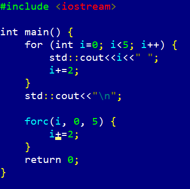
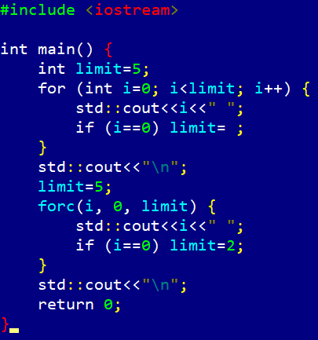
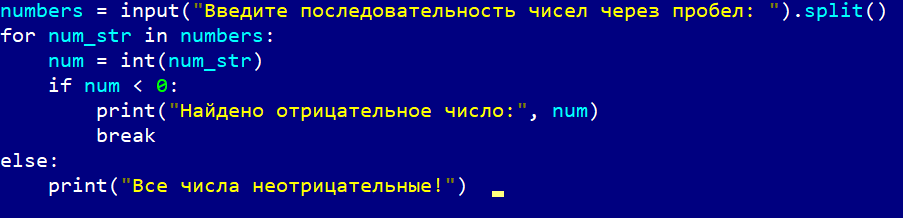
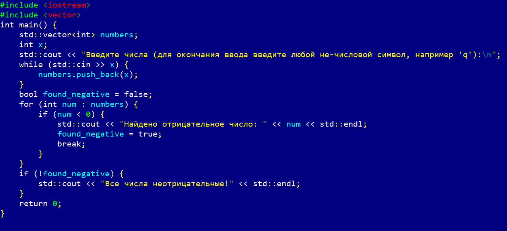
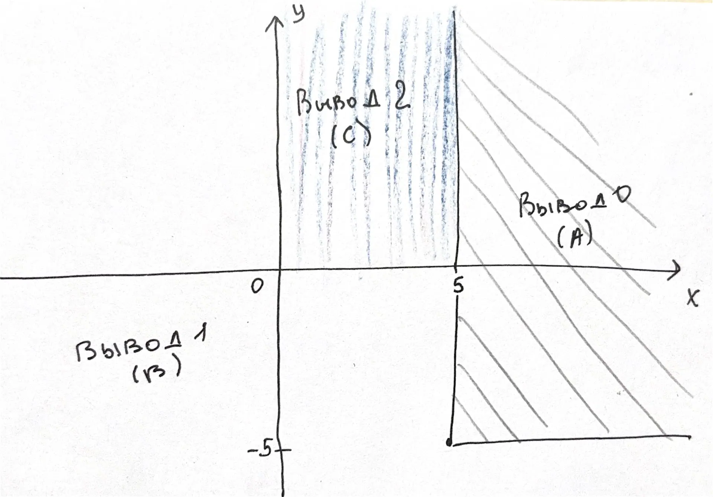

# Языки программирования
## Лабораторная работа 8

### Задание 1 **(2)**
*Рассмотрим программу на языке* **Python**.
```
x = [int(t) for t in input().split()]
for i in range(len(x)):
   if x[i] < i or x[i] > 2*i:
      break
print(i)
```
*Перепишите эту программу так, чтобы в ней использовался цикл* **while**, *в ней не использовалась
инструкция* **break**, *а используемый алгоритм не изменился. Полученная программа должна иметь следующий 
вид.*

```
x = [int(t) for t in input().split()]
i = 0
while ...:
   i += 1
print(i)
```
*Допишите правильное логическое выражение вместо многоточия. Выражение не должно содержать оператор* **not**.

```
x = [int(t) for t in input().split()]
i = 0
while (i < len(x) and x[i] >= i and x[i] <= 2*i):
   i += 1
print(i)
```
Для того, чтобы написать правильное логическое выражение, нужно найти отрицание условия прерывания, которое пока не выполнено и пока индекс в пределах списка, 
то цикл for c break продолжается.
 Отрицание этого условия даёт x[i] >= i and x[i] <= 2 * i.
После этого добавляем проверку границы i < len(x). Получается условие продолжения цикла while без not и без break.


### Задание 2 **(2)**
*Рассмотрим программу на языке* **Python**.
```
x = [int(t) for t in input().split()]
for i in range(len(x)):
   if i <= x[i] < 2*i or 3*i <= x[i] < 4*i:
      break
print(i)
```
*Перепишите эту программу так, чтобы в ней использовался цикл* **while**, *в ней не использовалась
инструкция* **break**, *а используемый алгоритм не изменился. Полученная программа должна иметь следующий 
вид.*
```
x = [int(t) for t in input().split()]
i = 0
while ...:
   i += 1
print(i)
```
*Допишите правильное логическое выражение вместо многоточия. Выражение не должно содержать оператор* **not**.
```
x = [int(t) for t in input().split()]
i = 0
while i < len(x) and (x[i] < i or x[i] >= 2*i) and (x[i] < 3*i or x[i] >= 4*i):
   i += 1
print(i)
```
Для того, чтобы написать правильное логическое выражение нужно также как и в 1 задании найти отрицание условя прерывания.
 Отрицание по закону де Моргана даёт конъюнкцию отрицаний каждого двойного неравенства: (x[i] < i or x[i] >= 2* i) и (x[i] < 3* i or x[i] >= 4* i).
Также добавляем границу i < len(x). Получаем нужное логическое выражение без оператора not.


### Задание 3 **(2)**

*Напишите пример программы на* **Java** *с двумя вложенными циклами и инструкцией* **break** *для выхода
из двух вложенных циклов. В качестве такой программы можно взять поиск первого нуля в двумерном массиве.*

```
public class FindFirstZero {
    public static void main(String[] args) {
        int[][] a = {{5, 3, 7}, {2, 0, 9}, {1, 4, 6}};
        int foundRow = -1;
        int foundCol = -1;
        boolean found = false;
        for (int i = 0; i < a.length && !found; i++) {
            for (int j = 0; j < a[i].length; j++) {
                if (a[i][j] == 0) {
                    foundRow = i;
                    foundCol = j;
                    found = true;
                    break;          
                }
            }
        }
        if (!found) {
            System.out.println("Ноль не найден");
        } else {
            System.out.println("Первый ноль: строка " + foundRow + ", столбец " + foundCol);
        }
    }
}
```
Это работает так:
Внутренний break выходит только из цикла по j,
 а флаг found в условии внешнего цикла не даёт внешнему циклу продолжить перебор. Получается, оба цикла останавливаются на первом найденном нуле.
### Задание 4 **(2)**

*Рассмотрим программу на языке* **Python**.
```
a = list(range(10))
b = [a.pop() - x for x in a]
print(*b)
```
*Объясните, почему список* **b** *получился именно таким.*

Список b получается именно таким, потому что  список a изменяется прямо во время работы с ним, то есть итератор перебирает элементы слева направо 
по индексам, а a.pop() в теле выражения каждый раз удаляет последний элемент и возвращает его.
 Итератор и pop() движутся навстречу друг другу. На 6 шаге итератор пытается взять a[5], но длина a уже равна 5 работа программы завершается. 
Получается, что b = [9, 7, 5, 3, 1]

### Задание 5 **(2)**

*Напишите программу на С++, которая прочитает натуральное число* **n**, *создаст вектор
из* **n** *элементов, прочитает значения элементов, добавит последний элемент вектора к каждому элементу 
(в том числе и к последнему), найдет и выведет количество положительных и отрицательных элементов вектора
после изменения. Из циклов в программе можно использовать только циклы по коллекции.*

```
#include <iostream>
#include <vector>

int main() {
    int n;
    std::cin >> n;

    std::vector<int> v(n);
    for (auto& x : v) {
        std::cin >> x;
    }

    int last = v.back();
    for (auto& x : v) {
        x += last;
    }

    int pos = 0, neg = 0;
    for (auto x : v) {
        if (x > 0) ++pos;
        else if (x < 0) ++neg;
    }

    std::cout << "Положительных: " << pos << "\n";
    std::cout << "Отрицательных: " << neg << "\n";

    return 0;
}
```
Сначала мы считываем n и вектор, после этого определяем последний элемент, прибавляем его ко всем. 
Далее подсчитываем положительные и отрицательные и выводм ответ. 

### Задание 6 **(3)**

*Представим, что в некотором будущем стандарте* **С++** *появится конструкция*
```
forc(i, from, to)
```
*которая будет раскрываться в следующий код.*
```
{
   int __i = from, __n=to;
   for(const int &i= __i; i < __n; __i++) {
      ...
   }
}
```
*Чем эта конструкция отличается от стандартного цикла* **for**? *Укажите два основных различия.
Напишите программы для демонстрации этих различий.*

*Написанные программы сохраните в папку с номером задания.*

Основные различия такие:

1) Переменная цикла i - константная ссылка. То есть в обычном for переменную цикла можно изменять в теле. В forc переменная i - const int&, поэтому присваивать ей нельзя.



2) Границы вычисляются один раз и изолированы. То есть В обычном for переменная цикла объявлена в области видимости, но её можно изменить. В forc: from и to вычисляются ровно один раз, 
 переменная i - ссылка на скрытую i, а не самостоятельная переменная.




### Задание 7 **(2)**

*Напишите программу на языке* **Python** *для проверки того, что все числа во введенной 
последовательности неотрицательные. Если в цикле будет найдено отрицательное число, цикл должен
прерваться и вывести найденное число. Если отрицательных чисел нет, то вывести некоторое сообщение об этом.*

*Программа должна использовать конструкцию* **for break else**.

*Запишите аналогичную программу на С++. Какие изменения в алгоритме решения в ней появились?. Почему?*

*Написанные программы сохраните в папку с номером задания.*

Программа на Python



Программа на С++



Главные отличия программы на C++ от программы на Python: появляется переменная-флаг и добавляется условный оператор if после цикла.

Такие изменения появились, потмоу что в C++ циклы не информируют о том, что они завершились.
 Если сработал break, программа просто выходит из цикла и идет дальше, не запоминая причину выхода, поэтому нужновручную отслеживать факт выхода из цикла с помощью дополнительной переменной. 
В Python есть конструкция for-else для таких случаев.


### Задание 8 **(2)**

*Рассмотрим следующую программу.* 
```
if x>=5 and y>=-5:
   print(0)
elif x<0 or y<0:
   print(1)
else:
   print(2)
```
*Нарисуйте на координатной плоскости множества значений при которых программа выводит 0, 1 и 2.*
*Фотографию рисунка вставьте в отчет*
*Опишите эти множества значений, используя язык теории множеств. Например,*
A = { (x,y)| x принадлежит [5;бесконечность), y принадлежит [-5;бесконечность)}.  

Вывод 0 - первое условие:

A = { (x,y)| x принадлежит [5; + бесконечность), y принадлежит  [-5; +бесконечность) }

Вывод 1 выполнено x<0 or y<0, но точка не попала в A. Точки вида x>=5, -5<=y< 0 сюда не входят:
 у них y<0, но их уже первое условие и 0.

 B = { (x,y)| x<0 или y<0 }\A.

Вывод 2 - все остальные точки: x>=0, y>=0 и при этом не в A, то есть x<5.

C = { (x,y)| x принадлежит [0; 5), y принадлежит [0; +бесконечность) }



###  Задание 9 **(3)**
*Напишите программу на языке Python для решения следующей задачи.*

*Задана пронумерованная последовательность логических значений* **t(0), t(1), ..., t(n)**, **t(i) принадлежит {False, True}**

*Последовательность обладает следующим свойством: существует некоторое число k такое, что 
все значения* **t(0), t(1), ..., t(k-1)** *равны* **False**, *а все значения* **t(k), ..., t(n)** *равны* **True**,
*то есть слева от* **k** *находятся значения* **False**, *а справа* - **True**. *Последовательность задается
функцией* **t(i)**, *которая возвращает логическое значение. Например, для тестирования эту функцию можно
задать следующим образом.*
```
def t(i):
   return i >= 1000
```

*Требуется написать программу, которая найдет число* **k**. *Программа должна реализовывать алгоритм 
бинарного поиска. Диапазон поиска задается переменными* **left** и **right**. *На каждом шаге вычисляется
центр диапазона, значение в нем проверяется, после чего диапазон сокращается в два раза.*

*Алгоритм должен быть записан через цикл* **while** *и реализовывать инвариант цикла*

t(left)=False ^ t(right)=True

```
left = -1
right = 10**18
while ...:
   mid = ...
   if t(mid):
      ...
   else:
      ...
print(...)
```

Программа:

```
def t(i):
    return i >= 1000
left = -1
right = 10**18
while right - left > 1:
    mid = (left + right) // 2
    if t(mid):
        right = mid
    else:
        left = mid
print("k =", right)
```

Сначала мы записываем начальные значения, потом берем середину диапазона, после этого сужаем границы. Получается благодаря такому алгоритму мы находим искомое k.