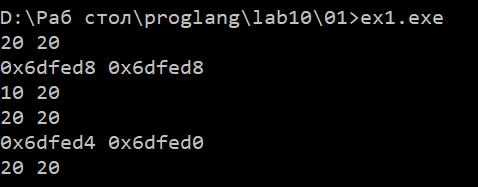
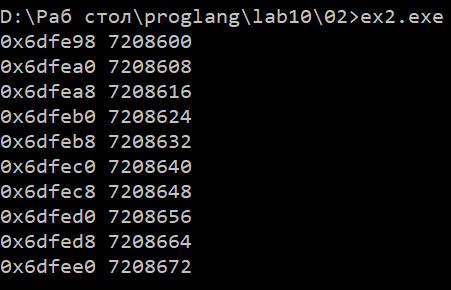
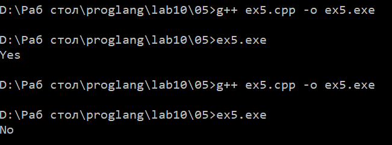
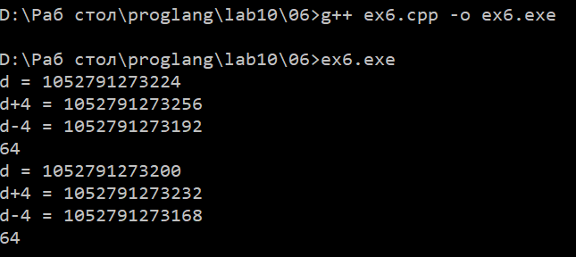
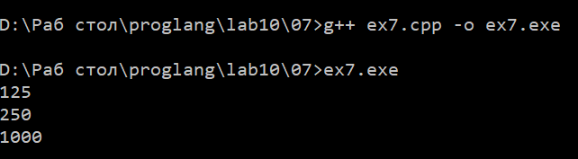
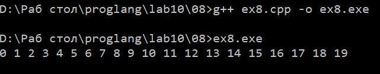
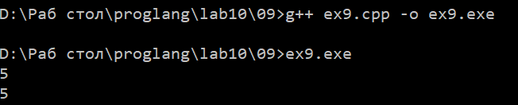

# Языки программирования
## Лабораторная работа 10

### Задание 1 **(2)**

*Рассмотрите следующие фрагменты программ. Запишите, что означают символы* **&** и  * *в каждом случае применения.*
```
int a = 10, b = 20;
int *p = &a , *q = &b;
p = q;
std::cout << *p <<' '<< *q << std::endl;
```
```
int a = 10, b = 20;
int *p = &a , *q = &b;
*p = *q;
std::cout << *p <<' '<< *q << std::endl;
```
*Чем различаются присваивания в третьей строке? Что можно вывести,
чтобы показать различия?*

*Примеры программ сохраните в папке с номером задания. Скриншоты работы прикрепите к отчету.*



```
int main(){
	{
	int a = 10, b = 20;
	int *p = &a , *q = &b;
	p = q;
	std::cout << *p <<' '<< *q << std::endl;
	std::cout << p <<' '<< q << std::endl;
	std::cout << a <<' '<< b << std::endl;
	}

	{
	int a = 10, b = 20;
	int *p = &a , *q = &b;
	*p = *q;
	std::cout << *p <<' '<< *q << std::endl;
	std::cout << p <<' '<< q << std::endl;
	std::cout << a <<' '<< b << std::endl;
	
	}
}

```

Символ * в объявлении переменной это описатель указателя.
 Символ * в выражении означает оператор разименования.
 Символ & означает оператор взятия адреса.

В первой программе адрес котрый был в q присваивается p. p q указывают на одну переменную b.
 Во втором случае они указывают на разные переменные и мы просто их скопировали. 


### Задание 2 **(1)**

*Рассмотрим следующую программу.* 
```
double x[10];
for (int i = 0; i <10; i++)
    std::cout << &x[i] << std::endl;
```
*Что она выводит? Измените
вывод так, чтобы адреса выводились в десятичной системе счисления.
Объясните почему числа составляют арифметическую прогрессию с
определенным шагом.*

*Записанную программу сохраните в папке с номером задания.*
*Скриншоты работы прикрепите к отчету.*
```
int main(){
	double x[10];
	for (int i = 0; i <10; i++)
    		std::cout << &x[i] <<' ' << reinterpret_cast<size_t>(&x[i]) << std::endl;
	return 0;
}
```
Исходная программа выводит 10 адресов элементов массива в шестнадцатиричеом виде.
 Массив double x[10] - это непрерывный блок памяти, в котором элементы расположены подряд, поэтому образуется арифметическая прогрессия. 
Шаг этой прогрессии 8, потому что размер double 8 байт.



### Задание 3 **(2)**

*Токен* **«*»** *в языке C++ может использоваться в трех различных
случаях. Аналогично токен* **«&»** *также может использоваться в трех
случаях. Приведите пример одной программы в которой они были бы
использованы во всех случаях.*

*Записанную программу сохраните в папке с номером задания.*

Случаи использования токенов

Токен *

1)умножение: a * b

2)объявление указателя: int * p
	
3)зазыменование: * p

Токен &:

1)поразрядное И: a & b

2)взятие адреса: &a

3)объявление ссылки: int &r 

```
#include<iostream>
int main(){
	int a=5,b=3;
	int x[10]={};
	int mul=a*b;
	int*p=&a;
	int val=*p;
	int band=a&b;
	int*addr=&a;
	int&ref=a;
	std::cout<<"mul  = "<<mul<<'\n' <<"val   = "<<val<<'\n'<<"band  = "<<band<<'\n'	<<"&a    = "<<addr<<'\n'<<"ref   = "<<ref<<'\n'	<<"&x[0] = "<<&x[0]<<'\n';
	return 0;
}
```

### Задание 4 **(2)**

*Выпишите значения всех переменных, в том числе указателей,
после выполнения каждой инструкции программы. Объясните, что
происходит в результате выполнения каждой инструкции.*
```
unsigned a = 8, b = 3 ,c = 17;
unsigned *p = &a;
unsigned *q = &b;
*p += *q + c;
c = *q;
p = &c;
c += a;
*p += 10;
*q = *p;
q = p ;
*q += 10;
```

1)unsigned a = 8, b = 3 ,c = 17; Это исходное состояние, объявление с инициализацией
 
* a=8, b=3, c=17, p=&a, q=&b

2)unsigned * p = &a; p получает адрес а, теперь указатель р смотрит на а

3)unsigned * q = &b; q получает адрес b

4)* p += * q + c; к значению по адресу р, то есть к а, прибавляется сумма значения по адресу q, то есть b, и c 

* a=28, b=3, c=17, p=&a, q=&b

5)c = * q; c присваиваем значение по адресу р, то есть 3

* a=28, b=3, c=3, p=&a, q=&b

6)p = &c; теперь р указывает на с, а не на а

* a=28, b=3, c=3, p=&c, q=&b

7)c += a; к с прибавляется а

* a=28, b=3, c=31, p=&c, q=&b

8)* p += 10; к значению по адресу р, то есть к с, прибавляется 10

* a=28, b=3, c=41, p=&c, q=&b

9)* q = * p; присваиваем b=c=41

* a=28, b=41, c=41, p=&c, q=&b

10)q = p ; q копирует адрес из p, тперь они оба указывают на с

* a=28, b=41, c=41, p=&c, q=&c

11)* q += 10; к с прибавлякм 10

* a=28, b=41, c=51, p=&c, q=&c


### Задание 5 **(1)**

*Что сравнивается в приведенной ниже программе? Как можно
изменить первую строчку программы, чтобы результат тоже
изменился?*
```
int x = 1, y = 2;
int *p = &y, *q = &x;
if (p < q)
    std::cout << "Yes";
else
    std::cout << "No";
```
Данная программа сравнивает значения указателей p и q, то есть адреса &y и &x, а не значения 1 и 2.
Чтобы изменился резульат можно поменять местами то, на какие элементы указывют p и q:
```
int x = 1, y = 2;
int *p = &x, *q = &y;
if (p < q)
    std::cout << "Yes";
else
    std::cout << "No";
```


### Задание 6 **(2)**

*Объясните работу следующей программы. Как изменится
результат, если тип* **double** *изменить на некоторый другой, например*
**int** *или* **char**?
```
double x = 0;
double *d = &x;
std::cout << reinterpret_cast<size_t>(d + 4) - reinterpret_cast<size_t>(d - 4) << std::endl;
```
В данной программе сначала создается переменная х типа double, потом указатель d получает адрес х.
 Далее к адресу прибаляется 4 * sizeof(double), то есть d + 4 * 8, аналогично и с вычитанием d-32. 
В итоге вычитаются два целых числа 32 - (-32) = 64

```
int main(){
	{
        double x = 0;
	double *d = &x;
	std::cout << "d = "<< reinterpret_cast<size_t>(d) << std::endl;
        std::cout << "d+4 = "<< reinterpret_cast<size_t>(d+4) << std::endl;
        std::cout << "d-4 = "<< reinterpret_cast<size_t>(d-4) << std::endl;
        std::cout << reinterpret_cast<size_t>(d + 4) - reinterpret_cast<size_t>(d - 4) << std::endl;
	}
	{
        std:: pair <double,int> x ={0, 0};
	double *d = &x.first;
	std::cout << "d = "<< reinterpret_cast<size_t>(d) << std::endl;
        std::cout << "d+4 = "<< reinterpret_cast<size_t>(d+4) << std::endl;
        std::cout << "d-4 = "<< reinterpret_cast<size_t>(d-4) << std::endl;
        std::cout << reinterpret_cast<size_t>(d + 4) - reinterpret_cast<size_t>(d - 4) << std::endl;
	}
	return 0;
}
```
При изменение типа данных будет меняться sizeof() конкретного типа данных, так как у разных типов разный размер, что непосредвтенно повлияет на сам результат


### Задание 7 **(2)**

*Объясните работу следующей программы. Как изменится
результат, если тип* **double** *изменить на некоторый другой, например*
**int** *или* **char**?
```
std::cout << reinterpret_cast <double*>(3000) - reinterpret_cast <double*>(2000) << std::endl;
```
Пргорамма работает следующим образом: целое число 3000 интерпретируется как адрес и приводится к указателю на double.
 После этого аналогичные действия происходят с 2000. 
Следующее, это вычитание двух указателей, оно происходит так: (3000-2000)/sizeof(double)=1000/8=125.
Получается программа выведет 125 
```
int main(){
	std::cout << reinterpret_cast <double*>(3000) - reinterpret_cast <double*>(2000) << std::endl;
	std::cout << reinterpret_cast <int*>(3000) - reinterpret_cast <int*>(2000) << std::endl;
	std::cout << reinterpret_cast <char*>(3000) - reinterpret_cast <char*>(2000) << std::endl;
}
```
В этом задании также как и в предыдущем, резульат будет меняться в соответствии с изменением sizeof() конкретного типа данных


### Задание 8 **(2)**

*Что надо дописать в записанной ниже программе вместо многоточий, чтобы
она выводила все числа из массива* **a**? *Почему?*
```
int a[20];
for ( int i = 0; i < 20; i++)
    a[i] = i;
int *b=a + 8;
for (int i =...; i <...; i++)
    std::cout << b[i] <<' ';
```
```
int main(){
	int a[20];
	for ( int i = 0; i < 20; i++)
    		a[i] = i;
	int *b=a + 8;
	for (int i = -8; i < 12; i++)
    		std::cout << b[i] <<' ';
	return 0;
}
```
Вместо многоточия дописали именно это, потому что b указывает на а[8], поэтому b[i]=a[8+i]. 
чтобы получить а[0] - a[19], индекс должен быть от -8 до 11.


### Задание 9 **(2)**

*Что выводит следующая программа? Изменится ли результат если
изменить тип элементов массива?*

```
int a[10];
std::cout << &a[8] - &a[3] << std::endl;
```
Данная программа выводит разность указателей, которая считается по формуле:
 (числовое значение &a[8] - числовое значение &a[3])/sizeof(int), 
что в свою очередь равняется (8 * sizeof(int) - 3 * sizeof(int))/sizeof(int), получается, что sizeof(int) сокращается и остается просто 5.

В таком случае резульат работы программы не изменится, если изменить тип элементов массива.
```
int main(){
	{
	int a[10];
	std::cout << &a[8] - &a[3] << std::endl;
	}
        {
	double a[10];
	std::cout << &a[8] - &a[3] << std::endl;
	}
	return 0;
}
```



### Задание 10 **(1)**

*Есть ли разница между инициализацией* **p** и **q** *в следующей программе? Обоснуйте ответ.*
```
int x [10]={1, 2, 3, 4, 5, 6, 7, 8, 9, 10};
int *p = x + 5;
int *q = &x[5];
```
1)в  выражении х+5 имя массива преобразуется к указателю, то есть получается x[0]+5 * sizeof(int). Результат x[5]

2)&x[5] это взятие адреса элемента х[5]

Получается, что обе инициализации будут эквивалентны, разницы между ними нет.

### Задание 11 **(3)**

*Указатели можно использовать для итерации по массивам.
Напишите программу, которая найдет сумму элементов массива,
используя указатели. В начале цикла указатель требуется установить
на начало массива, в конце каждой итерации смещать его к
следующему элементу массива через инкремент. Для выхода из цикла
надо проверять, что указатель дошел до конца массива.*
```
int x [10]={1, 2, 3, 4, 5, 6, 7, 8, 9, 10};
int s = 0;
for (int *p = ...; ...; ...)
    s += ...
std::cout << s;
```

*Записанную программу сохраните в папке с номером задания.*
```
int main(){
	int x [10]={1, 2, 3, 4, 5, 6, 7, 8, 9, 10};
	int s = 0;
	for (int *p =x; p<x+10; p++)
    		s += *p;
	std::cout << s;
	return 0;
}
```

